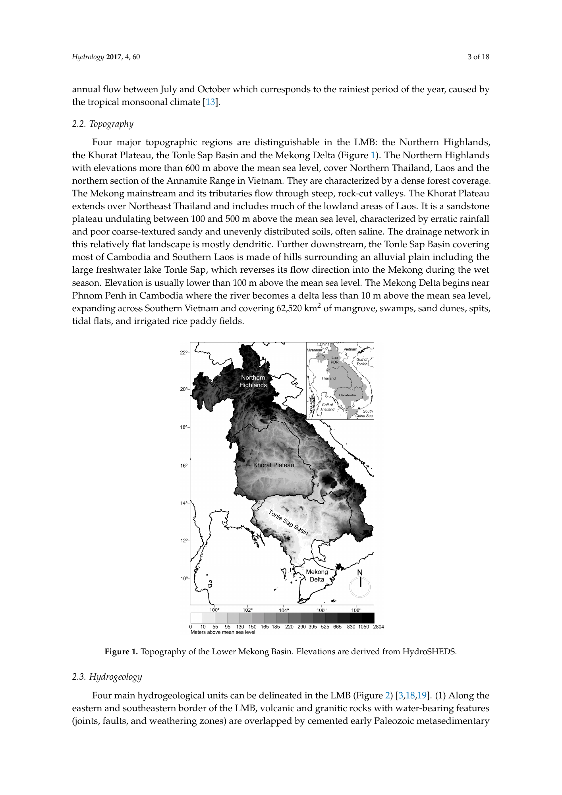
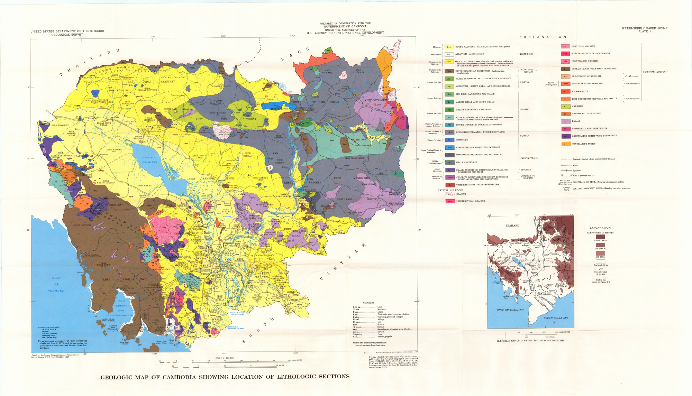
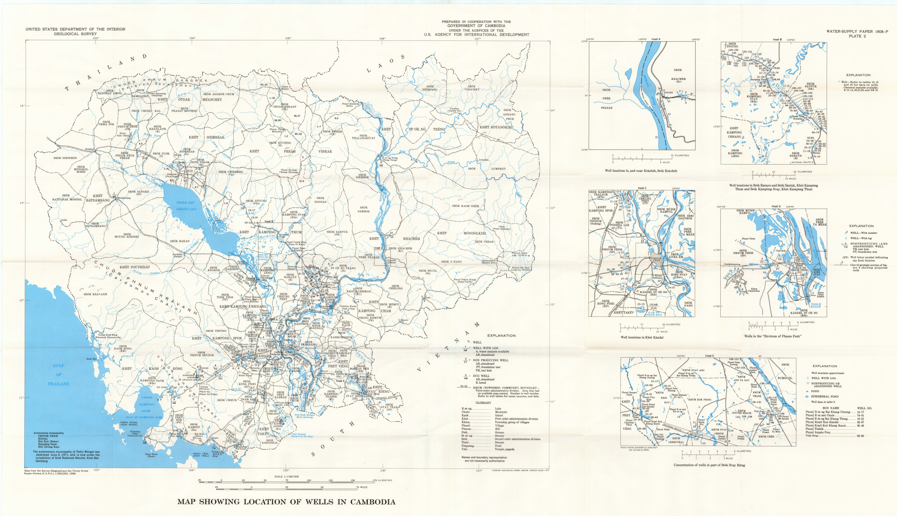
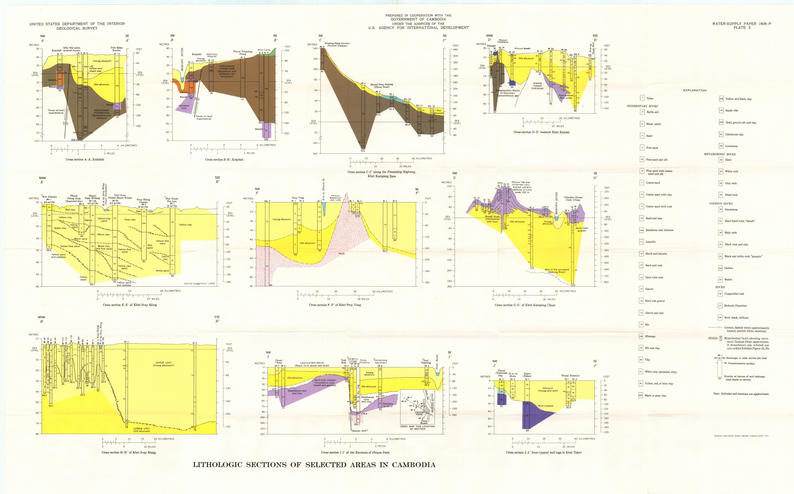
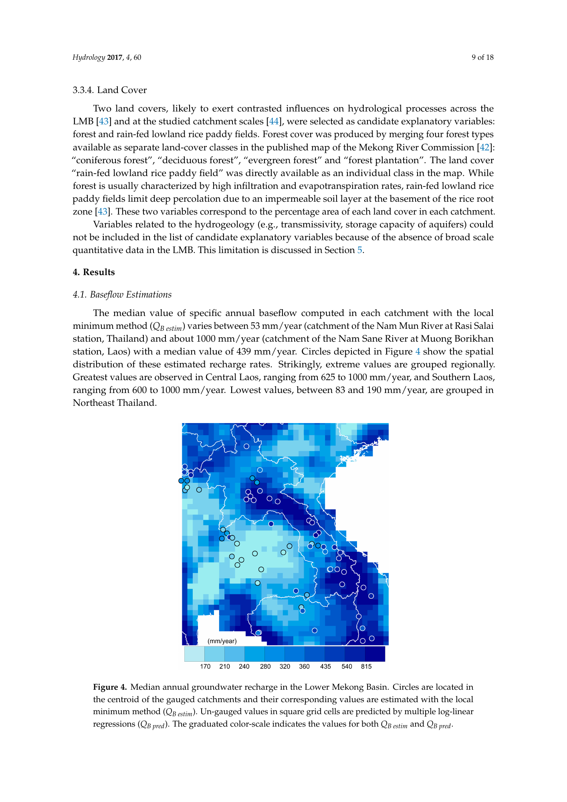
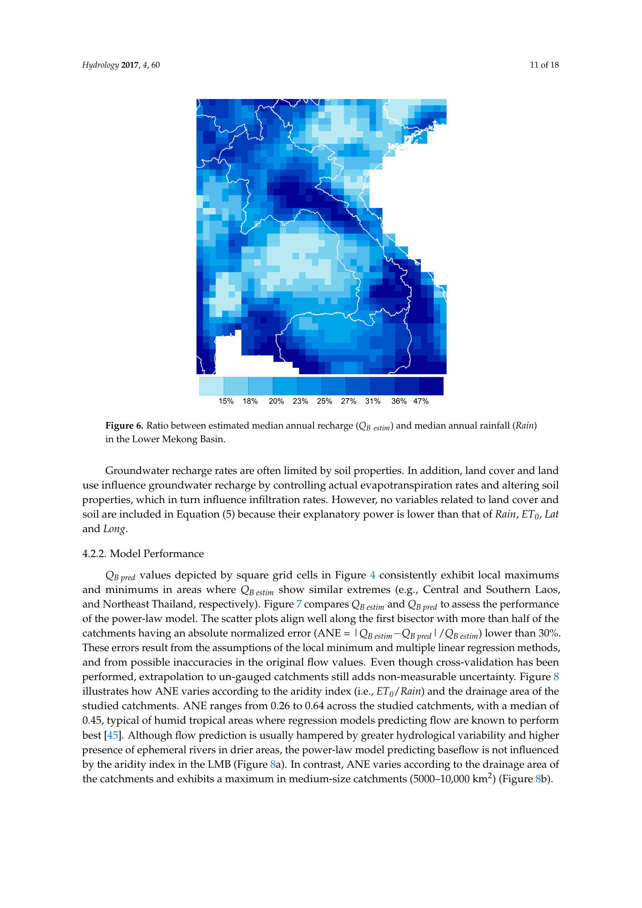

# Surface water and groundwater in Cambodia’s Lower Mekong Basin

River–aquifer exchange, recharge, water quality and sustainable use

Prepared 1 November 2026. GeoCam editorial research synthesis.

Cambodia’s water security depends on the seasonal connection between the Mekong, Tonle Sap, floodplains and aquifers. This review brings together basin hydrology, Cambodian groundwater studies and recent regional research to explain where water is stored, how it moves, and why water availability must be assessed together with quality and pumping pressure.

## ទឹកលើផ្ទៃ និងទឹកក្រោមដីក្នុងអាងទន្លេមេគង្គក្រោមនៅកម្ពុជា

សន្តិសុខទឹកនៅកម្ពុជាពឹងផ្អែកលើទំនាក់ទំនងតាមរដូវរវាងទន្លេមេគង្គ ទន្លេសាប តំបន់លិចទឹក និងអាងទឹកក្រោមដី។ ការពិនិត្យឯកសារនេះផ្តោតលើចលនាទឹក ការបំពេញបន្ថែមទឹកក្រោមដី គុណភាពទឹក និងការប្រើប្រាស់ប្រកបដោយចីរភាព។ ផែនទីកម្រិតតំបន់មិនអាចជំនួសការស្ទង់ និងការវិភាគទឹកនៅទីតាំងអណ្តូងជាក់លាក់បានទេ។

## What the evidence establishes

Cambodia’s surface water and groundwater form a connected seasonal system. Rainfall, river stage, floodplain inundation, sediment layers and pumping determine when water enters storage and when it returns to rivers or is withdrawn. Groundwater can support dry-season supply, but a productive well does not by itself establish a renewable or chemically suitable resource. [S01, S04, S05, S06]

The strongest practical conclusion is to manage quantity and quality together. Pumping decisions need aquifer tests and seasonal observations; drinking-water decisions need laboratory results and a reliable supply-management system. Published maps help locate questions and design investigations, while individual wells require their own evidence. [S04, S06, S08, S10]

This article is a documentary research synthesis, not a new field survey, a national groundwater inventory or a real-time hydrological assessment. The evidence spans historical reports from 1957 and 1977 to a regional groundwater review published in 2026. Different dates, methods and geographic scales are retained throughout.

## Cambodia within the Lower Mekong Basin

The Lower Mekong Basin and the Greater Mekong Region describe different areas. The basin is a drainage system shared by parts of Lao PDR, Thailand, Cambodia and Viet Nam, with upstream inflow from the Lancang–Mekong. The Greater Mekong groundwater review also covers aquifers outside that drainage basin, including systems in Myanmar and other parts of Thailand and Viet Nam. A regional aquifer map must therefore not be relabelled as a Lower Mekong catchment map. [S06, S11]

Cambodia receives the Mekong from the north, including contributions from the Sekong, Sesan and Srepok tributary system. Around Phnom Penh, the Mekong, Bassac and Tonle Sap River connect the upstream river corridor, the Great Lake and the downstream delta. Below Kratie, broad floodplains become central to seasonal storage and exchange. [S01, S02]

The Tonle Sap catchment and the Cambodian upper delta are the main lowland focus here. Northwestern and northeastern aquifers are included where they clarify Cambodian water supply. Coastal salinity and Kampot karst provide comparisons, but coastal catchments draining directly to the Gulf of Thailand are not automatically part of the Lower Mekong Basin. [S01, S06, S15]

Original Figure 1 on source PDF page 3. Lacombe et al. (2017); elevations derived from HydroSHEDS. Whole source page reproduced, with its original caption. This is a basin map, not a well-location dataset. CC BY 4.0 [S04]

## The flood pulse and the Tonle Sap connection

During rising Mekong stages, the hydraulic gradient can drive water along the Tonle Sap River toward the lake, expanding seasonal inundation. As river levels fall, lake water drains toward the Mekong. Floodplains store water, receive sediment and provide habitats linked to fisheries and farming; damaging floods and beneficial seasonal inundation are related but different management concerns. [S01, S02]

The 2005 basin overview and 2009 flow booklet provide historical explanations of this system. They should not be read as descriptions of unchanged present-day flow. The 2023 State of the Basin Report documents a redistribution toward higher dry-season and lower flood-season flows in recent decades, reduced Tonle Sap reverse flow, and a later or shorter flood season. The report attributes changes to interacting development pressures and climatic conditions; this synthesis does not assign a percentage of change to any individual dam. [S03]

For Cambodia, management should consider the timing, duration and connectivity of inundation as well as annual water volume. A similar annual total can accompany a different seasonal pattern. River observations and lake levels are therefore useful alongside rainfall, water-use records and floodplain mapping. This is a monitoring implication drawn from the documented seasonal system, not an additional measured trend. [S01, S02, S03]

## Where groundwater is stored

In lowland Cambodia, sand and gravel layers within alluvial deposits commonly form aquifers, while finer clay-rich layers impede vertical movement. The 2026 review describes both younger and older alluvium in the Tonle Sap plain and a layered Cambodian delta system. These categories are useful regional descriptors; they do not establish identical thickness, confinement or water quality everywhere. [S06, S07]

Younger floodplain deposits may contain local productive sand lenses within otherwise clay-rich material. Older alluvium can be an important source beneath or around the lowland margins. Bedrock aquifers in sandstone, basalt, weathered crystalline rocks and karst have different storage and flow behaviour. Their yields depend on connected fractures, weathering, sediment texture and well construction, rather than rock name alone. [S04, S06, S07, S15]

The USGS report and its plates provide a valuable historical map and cross-section baseline. They preserve well locations, lithology and the interpretation available at the time. Old province names, boundaries, settlement positions and drilling records need reconciliation with modern references before operational use. The plates are not a current drilling-success or drinking-water-safety map. [S07]

Rasmussen & Bradford (1977), USGS Water-Supply Paper 1608-P, Plate 1. Historical map and administrative labels retained. Not a present-day aquifer-yield or drinking-water-safety map. USGS public-domain government work [S07]

Rasmussen & Bradford (1977), Plate 2. Well locations and insets belong to the historical survey compilation; this plate does not describe the present operational well network. USGS public-domain government work [S07]

Rasmussen & Bradford (1977), Plate 3. Published cross-sections illustrate the arrangement of sediments and rock units along selected historical lines, not a uniform countrywide aquifer section. USGS public-domain government work [S07]

## How rivers and aquifers exchange water

A gaining river receives groundwater where groundwater head exceeds river stage. A losing river supplies an aquifer where the river is higher and the bed allows exchange. The direction can reverse seasonally, and river-connected storage may be partly returned during recession. Clay layers, riverbed sediments and the distance from the channel affect the size and timing of that response. [S05]

Raksmey, Jinno and Tsutsumi’s 2009 study coupled groundwater-flow and recharge models for central and southern Cambodia. In the simulated 2002 conditions, the downstream Mekong and Bassac could gain groundwater during the dry season and lose water toward aquifers during the wet season. Other modelled reaches received groundwater from upland margins. These are results for particular model reaches and assumptions, not a rule that every Tonle Sap bank behaves identically. [S05]

A seasonal rise in well level is evidence of changing hydraulic conditions, but it does not alone quantify recharge or identify the source of the water. Useful tests combine paired river-stage and well-head measurements, screened-depth information, groundwater chemistry and, where justified, environmental tracers. Pumping can change gradients and capture water that would otherwise discharge to a river. These are investigation priorities consistent with the interaction model and recharge assessment. [S04, S05]

## Recharge potential and the limits of regional maps

Lacombe and colleagues developed a Lower Mekong recharge model using baseflow estimates from 65 unregulated sub-catchments. The historical streamflow records fall within 1951–2007. Rainfall and evapotranspiration explain much of the spatial pattern at this scale; the prediction is mapped on a 0.25° grid. This resolution is appropriate for regional screening, not the design of an individual village well field. [S04, pp. 4–10]

The Cambodian comparisons in the paper are especially important. A northwestern sandstone study reported 10–70 mm/year, whereas the regional model indicated about 200 mm/year in that area. For a southeastern Cambodian case, a local groundwater model used about 20 mm/year, compared with about 230 mm/year in the regional assessment. Clay-rich cover and sparse local gauging are among the explanations discussed. These figures describe different methods and study footprints and must not be averaged into a single national rate. [S04, pp. 13–14]

Recharge is also different from a permissible pumping volume. A recharge estimate does not allocate the full amount to extraction: groundwater discharge supports rivers, wetlands and existing users, while changes in storage and lateral flow also matter. The water balance must be assessed over a suitable area and period, with drought and recovery included. No national safe yield or new extraction limit is calculated here. [S04, S09]

| Comparison in the 2017 paper | Local-study estimate | Regional-model value nearby | Interpretation |
| --- | --- | --- | --- |
| Northwestern Cambodia, sandstone setting | 10–70 mm/year | About 200 mm/year | Clay cover and local conditions limit direct transfer. |
| Southeastern Cambodian model case | About 20 mm/year | About 230 mm/year | Surface clay aquitard is a key explanation discussed. |

Source: Lacombe et al. 2017, discussion §5.2–5.3, PDF pp. 13–14 [S04]. These are comparisons reported by that paper, not measurements made for this website. Different study footprints and methods apply.

Original Figure 4 on source PDF page 9. Lacombe et al. (2017). Circles show catchment estimates and grid cells show regional predictions. The 0.25° grid is a screening product; local clay cover can produce substantially different recharge. Whole source page reproduced. CC BY 4.0 [S04]

Original Figure 6 on source PDF page 11. Lacombe et al. (2017). The regional ratio is method-dependent; it is not a fraction of rainfall that may automatically be allocated to pumping. Whole source page reproduced. CC BY 4.0 [S04]

## Arsenic, mineral reactions and other quality concerns

Arsenic is a major concern in parts of Cambodia’s young alluvial groundwater system. Cambodian field research demonstrates that arsenic can be released from near-surface, river-derived wetland sediments and transported through an aquifer. Redox conditions and groundwater flow both influence the resulting distribution. A district-level risk map cannot certify one household well. [S08]

The process connects hydrogeology with mineralogy: iron-bearing sediment phases can retain arsenic, while changes in reducing conditions and water–sediment interaction can release it. Iron staining or clear-looking water is not an arsenic test. The regional review treats arsenic, salinity and depletion as major development constraints; their overlap differs across aquifer units. [S06, S08]

WHO gives a provisional arsenic guideline value of 10 µg/L for drinking water. It is a health-based reference used here, not a statement of Cambodia’s current legal standard. Source selection and treatment need verified arsenic results and microbial safety; removing one chemical hazard does not establish that the water is safe overall. [S10]

Salinity may reflect coastal intrusion, older saline pore water, mineral dissolution or mixing; a high electrical-conductivity reading alone does not identify its source. The 2026 review distinguishes mapped observations from areas considered at risk. Salinity concerns reported for the wider Mekong Delta should not be transferred wholesale to every Cambodian floodplain aquifer. [S06]

The supplied 2018 field workbook and earlier hydrogeology page provide useful survey context, but field pH, conductivity and dissolved oxygen cannot substitute for laboratory arsenic, iron, manganese or microbiological results. Conductivity units in the supporting materials need reconciliation before conversion or threshold comparisons. This article does not publish unverified site contamination labels or reuse the earlier page’s summary statistics as new results. [S13, S14]

## Groundwater use, dry-season irrigation and competing demands

Groundwater offers practical advantages where surface water is seasonally scarce or difficult to distribute. Its availability can support domestic supply and supplementary irrigation, but local development also changes drawdown, pumping costs and hydraulic connections. The appropriate scale of assessment is the aquifer system and its users, not just one successful borehole. [S04, S06]

Erban and Gorelick’s 2016 modelling study identifies risks to shallow domestic water access from expansion of groundwater irrigation in Cambodia and discusses transboundary implications. Its projection horizon is tied to that study’s scenario and baseline. The reported “within 15 years” result must not be republished as a new countdown beginning in 2026 or as proof that depletion has already occurred everywhere. [S09]

A practical response is conjunctive assessment: compare seasonal surface-water supply, groundwater storage, demand, water quality and the cost of reliable delivery. Establish pumping inventories and monitor recovery after the irrigation season. Proposed expansions should assess effects on nearby domestic wells and river or wetland discharge before treating groundwater as an unlimited drought reserve. These are research and management recommendations, not validated allocation rules. [S04, S06, S09]

## Research priorities across Cambodia

Cambodia requires several complementary study settings rather than one uniform groundwater programme. The following priorities are an editorial synthesis of the reviewed evidence. They are study areas, not new protected areas, aquifer boundaries or claims of measured pollution. [S04, S05, S06, S15]

| Setting | Main question | Evidence to obtain |
| --- | --- | --- |
| Tonle Sap plain and lake margins | How do inundation, clay cover and sand lenses control shallow supply and exchange? | Seasonal heads, sediment logs, lake/river levels and local chemistry. |
| Phnom Penh–Kandal and Cambodian upper delta | Where do river water, wetland recharge and pumping influence aquifer chemistry? | Nested wells, screen depths, stage records, redox-sensitive chemistry and arsenic tests. |
| Prey Veng–Svay Rieng–Takeo lowlands | How does irrigation demand affect domestic access and transboundary gradients? | Abstraction inventory, pumping/recovery tests and cross-border aquifer correlation. |
| Northwestern sandstone terrain | Where does clay cover restrict recharge despite regional-model potential? | Local stratigraphy, piezometers, recharge-method comparison and dry-season recovery. |
| Northeastern tributary and basalt terrain | Which weathered and fractured zones store and transmit water locally? | Borehole logs, fracture/weathering characterization and tributary baseflow records. |
| Coastal and karst comparisons | How do salinity and rapid conduit flow alter vulnerability outside the main lowland focus? | Site-specific chemistry, spring/cave flow and verified basin boundaries. |

Proposed research priorities synthesised from S04, S05, S06 and S15. Province groups are planning contexts, not mapped aquifer boundaries.

## A focused surface-water and groundwater research programme

First, assemble the existing evidence: borehole logs, screen depths, pumping tests, abstraction estimates, river and lake gauges, rainfall records, floodplain elevations and water chemistry. Store dates, coordinates, vertical datums and units with each observation. River stage and groundwater head can be compared only after their reference elevations are reconciled. This is a proposed evidence-management workflow. [S04, S05, S06]

Second, monitor seasonal exchange along selected river-to-floodplain transects. Pair water-level records with field conductivity and temperature, and collect laboratory samples appropriate to the intended water use. Repeat observations across rising water, peak inundation, recession and the late dry season. Keep raw records separate from corrected values, document gaps and do not interpolate a missing season into an apparent measured trend.

Third, test site-scale recharge and pumping responses. Combine aquifer tests, water-level recovery, local stratigraphy and water balances. Where groundwater-source attribution changes a decision, use suitable geochemical or isotope methods with a clear sampling design. Evaluate uncertainty before using a regional recharge product to support a local irrigation proposal. [S04, S05]

Finally, connect the Cambodian upper delta evidence with Viet Nam through compatible hydrostratigraphic descriptions and monitoring practices. A 2026 governance study provides a framework for the shared Cambodia–Mekong River Delta aquifer system; only its abstract and metadata were checked here, so this article does not reproduce its scores or claim that its recommendations have been implemented. [S17]

## Reading the maps and the evidence responsibly

The public figure gallery uses original USGS plates and source pages from the CC BY recharge paper. Whole-page reproductions retain the published legends and captions; the figures are not newly georeferenced GIS layers. Each caption states the source date and geographic scope. Open the source PDF for full detail.

The 2026 aquifer map is available from its original Zenodo record. Its companion paper is CC BY-NC 4.0, and the inspected repository text did not expose an unambiguous separate map licence. The map and threat figures are therefore linked rather than silently bundled for unrestricted commercial reuse. This does not reduce their value as cited research evidence. [S06, S16]

The 1957 ECAFE report documents the early development-planning history of the basin; the 1977 USGS report preserves an important hydrogeological baseline. Their population figures, administrative names, development assumptions and water-quality statements must not be presented as current Cambodian conditions. [S07, S12]

The earlier website package, GDMR presentation and field workbook remain supporting local materials. This publication extends their subject matter; it does not replace them, certify raw data or imply institutional endorsement. English is the full research text. The Khmer title and overview are an editorial summary and should receive fluent Khmer scientific review before use as a formal translation.

## Annotated source catalogue

### S01 Overview of the Hydrology of the Mekong Basin

Mekong River Commission (2005). Supplied full text; historical basin baseline.

[Original source](https://archive.iwlearn.net/mrcmekong.org/download/free_download/Hydrology_report_05.pdf)

Reuse: Copyright MRC; link to the archived MRC source, no full PDF redistributed.

### S02 The Flow of the Mekong, Management Information Booklet Series No. 2

Mekong River Commission (2009). Supplied full text; reach structure and seasonal flood-pulse explanation.

[Original source](https://staging.mrcmekong.org/wp-content/uploads/2024/08/MRC-Management-Information-Booklet-Series-No.2-The-Flow-of-the-Mekong.pdf)

Reuse: Copyright MRC; linked rather than reproduced.

### S03 Mekong River Basin 2023 State of the Basin Report

Mekong River Commission (2024). Official report sections on flow conditions and synthesis inspected online; basin evidence through the report period, not live 2026 observations.

[Original source](https://doi.org/10.52107/mrc.c3eper)

Reuse: MRC educational/non-profit reproduction terms require acknowledgement and notification; figures are not reproduced here.

### S04 Regional Assessment of Groundwater Recharge in the Lower Mekong Basin

Lacombe, G.; Douangsavanh, S.; Vongphachanh, S.; Pavelic, P. (2017). Supplied full text; Hydrology 4, 60. Historical flow records 1951–2007; regional model, not a well-scale allocation.

[Original source](https://doi.org/10.3390/hydrology4040060)

Reuse: CC BY 4.0; original source pages and article supplied with attribution.

### S05 Effects of River Water on Groundwater in Cambodia

Raksmey, M.; Jinno, K.; Tsutsumi, A. (2009). Supplied full text; Memoirs of the Faculty of Engineering, Kyushu University 69(3), 95–115. Model output discussed for 2002.

[Original source](https://hdl.handle.net/2324/15542)

Reuse: Repository rights not established for public reproduction; text paraphrased and source linked.

### S06 Groundwater resources in the Greater Mekong Region: A review

Viossanges, M.; Batelaan, O.; Pavelic, P.; Banks, E.W.; and colleagues (2026). Supplied full text; Journal of Hydrology: Regional Studies 66, 103560. Online 6 June 2026; synthesis of 179 documents.

[Original source](https://doi.org/10.1016/j.ejrh.2026.103560)

Reuse: CC BY-NC 4.0; figures and article not included in the public upload folder, avoiding an assumption about commercial website use.

### S07 Ground-Water Resources of Cambodia, USGS Water-Supply Paper 1608-P

Rasmussen, W.C.; Bradford, G.M. (1977). Supplied full text and three map plates; historical drilling and mapping baseline, mainly 1960–1963 records.

[Original source](https://doi.org/10.3133/wsp1608P)

Reuse: USGS-authored government report and plates; public-domain source material, credited.

### S08 Near-surface wetland sediments as a source of arsenic release to ground water in Asia

Polizzotto, M.L.; Kocar, B.D.; Benner, S.G.; Sampson, M.; Fendorf, S. (2008). Publisher/PubMed abstract inspected; Nature 454, 505–508. Cambodian field-process evidence; not a national prevalence estimate.

[Original source](https://doi.org/10.1038/nature07093)

Reuse: Publisher copyright; linked, no figure reproduced.

### S09 Closing the irrigation deficit in Cambodia: Implications for transboundary impacts on groundwater and Mekong River flow

Erban, L.E.; Gorelick, S.M. (2016). Authors’ Stanford publication record inspected; Journal of Hydrology 535, 85–92. Model/scenario result, not a verified 2026 forecast.

[Original source](https://doi.org/10.1016/j.jhydrol.2016.01.072)

Reuse: Publisher copyright; linked, no figure reproduced.

### S10 Arsenic fact sheet and drinking-water guidance

World Health Organization (2022). Official fact sheet and chemical guidance checked; provisional guideline 10 µg/L.

[Original source](https://www.who.int/news-room/fact-sheets/detail/arsenic)

Reuse: WHO source linked; no copied figures.

### S11 Transboundary River Basin Overview – Mekong

FAO AQUASTAT (2011). Supplied full text; dated basin overview. Historical water-use estimates are not presented as current.

[Original source](https://www.fao.org/aquastat/en/countries-and-basins/transboundary-river-basins/)

Reuse: FAO source linked; no source figures reproduced.

### S12 Development of Water Resources in the Lower Mekong Basin, Flood Control Series No. 12

United Nations ECAFE (1957). Supplied full text and official ESCAP repository record checked; early reconnaissance and development-planning history.

[Original source](https://hdl.handle.net/20.500.12870/3708)

Reuse: UN copyright; no figures or full document redistributed.

### S13 Overview of Study on Hydrogeological Survey and Water Resources Utilization in Cambodia

Heng Sambo / Geological Department, GDMR (undated). Supplied presentation and existing website page; supporting context for survey design and historical monitoring. Presentation date and original figure rights unresolved.

Reuse: Do not redistribute original presentation imagery automatically.

### S14 Hydrogeology and Environmental geology survey data

User-supplied CGS–GDMR survey workbook (2018). Local field workbook; supporting asset only in this review. No new statistical analysis or laboratory water-quality validation is asserted.

Reuse: Raw workbook retained locally; not published as validated water-quality data.

### S15 The karst water environment in Southeast Asia: characteristics, challenges, and approaches

Jiang, G.; Chen, Z.; Siripornpibul, C.; and colleagues (2020 online). Supplied full text; Southeast Asian context, not a detailed assessment of every Cambodian karst aquifer.

[Original source](https://doi.org/10.1007/s10040-020-02267-y)

Reuse: Springer copyright; no source figures reproduced.

### S16 Hydrogeological Map of the Greater Mekong Region

Viossanges, M. and colleagues (2026). Zenodo record inspected; associated map and GIS files are available from the original repository.

[Original source](https://doi.org/10.5281/zenodo.18646250)

Reuse: Repository page did not expose an unambiguous licence in the inspected text; link to original map rather than redistribute GIS data.

### S17 Assessment of groundwater governance in the transboundary Cambodia-Mekong River Delta Aquifer System: Generic framework formulation and application

Uprety, T.; Shrestha, S.; Kc, S.; Shanmugam, M. (2026). Abstract and bibliographic metadata inspected; Environmental Management 76(3), 89. Framework only; no index scores used.

[Original source](https://doi.org/10.1007/s00267-026-02388-2)

Reuse: Linked; no full-text access claimed.

### S18 Annual Mekong Hydrology, Flood and Drought Report 2023

Mekong River Commission (2024). Official publication metadata inspected; listed as a follow-up monitoring source. No numerical result extracted from this report.

[Original source](https://doi.org/10.52107/mrc.CXAJVT)

Reuse: Linked; not redistributed.
